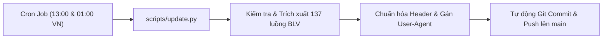

<div align="center">

# ⚽ IPTV THỂ THAO & BÌNH LUẬN VIÊN TIẾNG VIỆT

[](sport_tivimate.m3u)
[](sport.m3u)
[](https://github.com/bqhai199x/iptv/actions)
[](README.md)

<p align="center">
  <b>Tổng hợp 137 luồng Thể thao & Bình luận viên (BLV) tiếng Việt chất lượng cao.</b><br>
  Tương thích hoàn hảo với <b>TiviMate, OTT Navigator, Televizo, Kodi, VLC Media Player, vBook</b>.<br>
  Tích hợp <b>GitHub Actions</b> tự động kiểm tra và làm mới luồng 2 lần/ngày.
</p>

---

</div>

## 📑 Mục Lục

- [🔗 Danh Sách Link Nguồn (Raw URLs)](#-danh-sách-link-nguồn-raw-urls)
- [📋 Danh Mục Nhóm Kênh](#-danh-mục-nhóm-kênh)
- [📺 Hướng Dẫn Thêm Vào Ứng Dụng](#-hướng-dẫn-thêm-vào-ứng-dụng)
  - [1. TiviMate IPTV (Khuyên Dùng Trên Android TV)](#1-tivimate-iptv-khuyên-dùng-trên-android-tv)
  - [2. OTT Navigator IPTV](#2-ott-navigator-iptv)
  - [3. VLC Media Player (Windows / macOS / Mobile)](#3-vlc-media-player-windows--macos--mobile)
- [⚙️ Cấu Hình Kỹ Thuật Quan Trọng](#️-cấu-hình-kỹ-thuật-quan-trọng)
- [🔄 Cơ Chế Tự Động Cập Nhật (CI/CD)](#-cơ-chế-tự-động-cập-nhật-cicd)
- [💻 Chạy Server Xem Nội Bộ (Local LAN)](#-chạy-server-xem-nội-bộ-local-lan)
- [⚠️ Tuyên Bố Miễn Trừ Trách Nhiệm](#️-tuyên-bố-miễn-trừ-trách-nhiệm)

---

## 🔗 Danh Sách Link Nguồn (Raw URLs)

Copy trực tiếp các link bên dưới dán vào trình phát IPTV của bạn:

| Loại Playlist | Định Dạng | Ứng Dụng Đề Xuất | Đường Dẫn Trực Tiếp (Raw URL) |
| :--- | :---: | :--- | :--- |
| **Thể Thao BLV (Pipe UA)** | `.m3u` | **TiviMate, OTT Navigator, Kodi** | `https://raw.githubusercontent.com/bqhai199x/iptv/refs/heads/main/sport_tivimate.m3u` |
| **Thể Thao BLV (Chuẩn M3U)** | `.m3u` | **VLC, Televizo, Perfect Player** | `https://raw.githubusercontent.com/bqhai199x/iptv/refs/heads/main/sport.m3u` |
| **Direct File (Không đuôi)** | Text | **Tất cả các trình phát hỗ trợ Raw** | `https://raw.githubusercontent.com/bqhai199x/iptv/refs/heads/main/sport` |

---

## 📋 Danh Mục Nhóm Kênh

Kho lưu trữ gồm **137 kênh thể thao** bình luận tiếng Việt trực tiếp, phân chia theo từng đài:

| Nhóm Kênh | Số Lượng | Định Dạng Luồng | Trạng Thái Logo |
| :--- | :---: | :---: | :---: |
| 🔴 ⚽ **COLA TV** | 27 kênh | HLS (`.m3u8`) | Đầy đủ |
| 🔴 ⚽ 🏀 **COLA TV SV2** | 26 kênh | HLS (`.m3u8`) | Đầy đủ |
| 🔴 ⚽ 🏀 **COLA TV SV3** | 26 kênh | HTTP-FLV (`.flv`) | Đầy đủ |
| 🔴 ⚽ **GÀ VÀNG 33** | 10 kênh | HLS (`.m3u8`) | Đầy đủ |
| 🔴 ⚽ **GÀ VÀNG 33 SV2** | 11 kênh | HTTP-FLV (`.flv`) | Đầy đủ |
| 🔴 ⚽ 🏐 **KHÁN ĐÀI TV** | 10 kênh | HLS (`.m3u8`) | Đầy đủ |
| 🔴 ⚽ 🏐 **GÀ VÀNG 24h** | 18 kênh | HTTP-FLV (`.flv`) | Đầy đủ |
| 🔴 ⚽ 🏐 **XÔI CHÈ TV** | 9 kênh | HLS (`.m3u8`) | Đầy đủ |

---

## 📺 Hướng Dẫn Thêm Vào Ứng Dụng

### 1. TiviMate IPTV (Khuyên Dùng Trên Android TV)
1. Mở **TiviMate** ➔ vào **Cài đặt (Settings)** ➔ **Danh sách phát (Playlists)** ➔ **Thêm danh sách phát (Add playlist)**.
2. Chọn **Danh sách M3U (M3U playlist)**.
3. Dán đường dẫn:
   ```text
   https://raw.githubusercontent.com/bqhai199x/iptv/refs/heads/main/sport_tivimate.m3u
   ```
4. Đặt tên danh sách: `Thể Thao BLV`.
5. Bật tùy chọn **Tự động cập nhật danh sách khi khởi động (Auto-update playlist on app start)**.

### 2. OTT Navigator IPTV
1. Vào **Cài đặt (Settings)** ➔ **Nhà cung cấp (Providers)** ➔ **Thêm nhà cung cấp (Add provider)**.
2. Chọn loại **Playlist M3U**.
3. Dán link `https://raw.githubusercontent.com/bqhai199x/iptv/refs/heads/main/sport_tivimate.m3u`.
4. Bật chế độ tự động làm mới hàng ngày (**Update daily**).

### 3. VLC Media Player (Windows / macOS / Mobile)
1. Mở VLC ➔ nhấn tổ hợp phím `Ctrl + N` (hoặc vào `Media` ➔ `Open Network Stream`).
2. Dán link:
   ```text
   https://raw.githubusercontent.com/bqhai199x/iptv/refs/heads/main/sport.m3u
   ```
3. Nhấn **Play** để bắt đầu thưởng thức.

---

## ⚙️ Cấu Hình Kỹ Thuật Quan Trọng

### 1. Vấn đề User-Agent (Khắc phục lỗi 403 Forbidden)
- Các máy chủ trực tiếp bóng đá yêu cầu User-Agent di động hợp lệ để tránh bị chặn.
- File `sport_tivimate.m3u` đã được cấu hình sẵn chuỗi User-Agent trực tiếp vào từng luồng qua cú pháp pipe:
  ```text
  |User-Agent=Mozilla/5.0 (Linux; Android 10; K) AppleWebKit/537.36 (KHTML, like Gecko) Chrome/120.0.0.0 Mobile Safari/537.36
  ```
- Nếu dùng ứng dụng yêu cầu thiết lập thủ công, hãy dán chuỗi User-Agent trên vào mục cấu hình của Player.

### 2. Xử lý định dạng luồng HTTP-FLV (Gà Vàng, Cola TV SV3)
- Một số đài thể thao truyền luồng dưới định dạng `.flv`. Trình phát mặc định của Android TV (ExoPlayer) đôi khi chỉ phát âm thanh mà không có hình.
- **Cách khắc phục**:
  - **TiviMate**: Vào **Cài đặt** ➔ **Phát lại (Playback)** ➔ chọn **Bộ giải mã phần mềm (Software Decoder)**, hoặc bật **Sử dụng trình phát ngoài** (chọn VLC Player / Nova Player).
  - **OTT Navigator**: Cài đặt ➔ Phát lại ➔ Bộ giải mã ➔ Chọn **IjkPlayer (Auto)** hoặc **VLC**.

### 3. Khung giờ phát sóng trực tiếp
> [!NOTE]
> Các kênh BLV hoạt động theo lịch phát sóng của các trận bóng đá trực tiếp. Ngoài khung giờ thi đấu, luồng có thể trả về tín hiệu nghỉ hoặc tạm dừng kết nối.

---

## 🔄 Cơ Chế Tự Động Cập Nhật (CI/CD)

Kho lưu trữ tích hợp sẵn quy trình tự động hóa qua [GitHub Actions](.github/workflows/update-playlist.yml):



> [!IMPORTANT]
> **Cấp quyền ghi cho GitHub Actions**:
> Để GitHub Actions tự động commit danh sách mới, trên repo này hãy vào:
> **Settings** ➔ **Actions** ➔ **General** ➔ mục **Workflow permissions** ➔ tick chọn **Read and write permissions** ➔ bấm **Save**.

---

## 💻 Chạy Server Xem Nội Bộ (Local LAN)

Nếu muốn phát thử nghiệm qua mạng Wi-Fi nội bộ trong gia đình:

```powershell
python server.py
```
Màn hình sẽ hiển thị địa chỉ IP nội bộ (ví dụ: `http://192.168.1.x:8080/sport_tivimate.m3u`) để bạn dán vào TV Box trong cùng mạng.

---

## ⚠️ Tuyên Bố Miễn Trừ Trách Nhiệm

- Dự án này **không trực tiếp lưu trữ, tiếp sóng hoặc phát tán** bất kỳ nội dung video hay tín hiệu truyền hình nào.
- Toàn bộ danh sách kênh và liên kết đều được tổng hợp tự động từ các nguồn công khai trên mạng Internet.
- Dự án được xây dựng phục vụ mục đích nghiên cứu học tập và tối ưu hóa trải nghiệm xem cá nhân phi thương mại.
